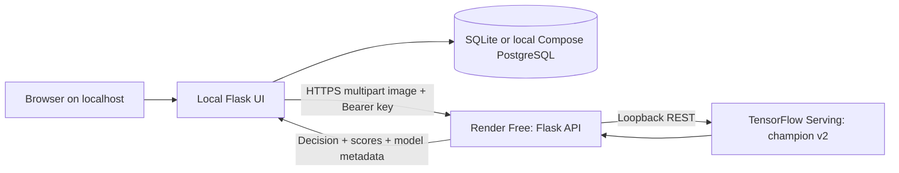

# Inference hosting — Render Free

Project: **23l-0829_A2_Ops**. The selected architecture keeps Flask and history on
localhost and hosts only the model API on Render, matching the Task 7 instruction
to call the cloud model from a local Flask application.



## Why this host and runtime

Render supports Docker web services on its free plan. A free service sleeps after
15 minutes without inbound traffic and usually takes about a minute to wake.
Its filesystem is ephemeral, so the cloud API is stateless; persistent prediction
history stays in the local database. Free Render PostgreSQL expires after 30 days,
so this design does not rely on it. See [Render's free-service terms](https://render.com/docs/free)
and [Docker support](https://render.com/docs/docker).

A regular Python TensorFlow process was too close to or above the free service's
512 MB memory budget in local profiling. The cloud image therefore uses the
official TensorFlow Serving **2.20.0** C++ executable plus a thin Flask/Gunicorn
API. This serves a SavedModel exported from the original champion, with identical
byte decoding, antialiased aspect-ratio padding, model normalization, weights,
and threshold. No retraining or quantization is involved. The UI can still use
the original Keras model in local mode.

The Docker build downloads the public champion at a fixed DagsHub Git revision,
checks both model and manifest SHA-256 against `deploy/model.lock.json`, and
exports the serving graph. It does not need a DagsHub token. The final API image
contains neither the training Python environment nor any `.env` file. Only the
Gunicorn HTTP port is intended for public access; TensorFlow Serving is an
internal dependency. Its model is loaded before the public API starts.

The Dockerfile also has a `web` target for the local Flask/Compose stack, using
CPU-only Python TensorFlow. Dependencies are installed before copying source to
reuse the large layer when application code changes. Both targets run as UID
10001 and have HTTP health checks.

## Measured local container verification

The complete API image ran under a **512 MiB hard memory/swap limit** and one CPU.
Docker bridge creation is unavailable on this host, so these tests used
`--network none` with HTTP clients executing inside the container. This proves
container/model behavior, not public network reachability or the Compose network.

| Check | Observed result |
| --- | --- |
| API health | HTTP 200, champion registry version 2 ready |
| Container UID | 10001 |
| Missing API key | HTTP 401 |
| Real validation image | Real, p(AI) 0.304313421 |
| AI validation image | AI, p(AI) 0.757909238 |
| Largest score difference from saved validation output | 3.02e-7 |
| Wrong type / corrupt / oversized | HTTP 415 / 422 / 413 |
| 2000×2000 JPEG and PNG | Both HTTP 200 at the 4-million-pixel boundary |
| Local Flask client → actual HTTP API | Two results persisted; history HTTP 200 |
| Repeated result GET | No repeat inference or duplicate prediction |
| Database reopened | Both remote prediction records remained |
| Peak cgroup memory | 341,172,224 bytes, approximately 325.4 MiB |
| Out-of-memory kill | False |

The memory peak includes the server, its image processing, and test-client
processes inside the same container. Warm usage after the checks was about
240 MiB. This provides local evidence that the image fits the free memory budget;
actual Render startup, cold starts, and public requests still require deployment.
The local `web` Docker target also built successfully and passed real HTTP
inference/history checks with the original Keras model.

The local web image is **2,200,499,661 bytes**; the multi-stage inference image is
**1,216,319,411 bytes**, a **44.73%** reduction. Both serve the same model, while
the API image omits Python TensorFlow and local-history features. These are Docker
uncompressed image sizes, not runtime RAM measurements. The largest API layer is
the C++ model-server executable. Complete layer listings and smoke-test responses
are saved in `reports/generated/serving/` and versioned through DVC.

## Create the free service

The Render integration must be connected to an account before automated service
creation. Alternatively, use these dashboard steps:

1. Sign in to [Render](https://dashboard.render.com/) and connect the GitHub
   repository `saadzafar0/mlops-assignment-visionguard`.
2. Create a **Blueprint** from the repository's `render.yaml`, or create a
   **Web Service** manually with language **Docker**, branch `main`, repository
   root as build context, and Dockerfile path `./Dockerfile`.
3. Select the **Free** instance. Use service slug `23l-0829-a2-ops-inference` and
   project/display name `23l-0829_A2_Ops` where the provider permits underscores.
4. Set the secret `INFERENCE_API_KEY` to the same randomly generated value held
   in the local ignored `.env`. Do not paste it into Git, chat, or screenshots.
   The Blueprint prompts for this value via `sync: false`.
5. Set `PROJECT_NAME=23l-0829_A2_Ops`, `API_REQUIRE_KEY=true`, and
   `INFERENCE_BACKEND=tensorflow-serving`; the Blueprint includes these.
6. Use health-check path `/health`. Keep the Docker startup command from the
   image; it honors Render's `PORT` environment variable.
7. Deploy. Check build logs for verified champion version 2, then service logs
   for model readiness and Gunicorn startup. Save the actual `https://…onrender.com`
   URL once `/health` returns HTTP 200 with `model_loaded: true`.

No cloud database or paid service is declared in the Blueprint. Actual cloud
deployment and its public URL remain pending until the account is connected.
The repository's build configuration alone is not evidence of a live deployment.

## Troubleshooting: missing Render API key

The first attempted cloud deployment built successfully, fetched the verified
champion, loaded the SavedModel, and bound Gunicorn to Render's port 10000.
The worker then exited with code 3 and this application error:

```text
ValueError: Set INFERENCE_API_KEY before starting the public inference API
```

This means the service's runtime environment had no nonempty `INFERENCE_API_KEY`.
The local ignored `.env` is deliberately excluded from the image, and creating a
manual Web Service does not automatically apply the Blueprint's environment
settings. TensorFlow's CPU-feature messages and absent warmup-file notice were
informational; the model had already loaded successfully.

Open **Render Dashboard → this service → Environment**, add `INFERENCE_API_KEY`
with the same value as the local ignored `.env`, keep `API_REQUIRE_KEY=true`,
then save and redeploy. No model changes or retraining are needed. Do not disable
API authentication to bypass this configuration error.

The startup script now checks this setting first and exits with a short actionable
message (code 64) before launching TensorFlow Serving if it is missing. The
application factory independently retains its missing-key check.

## Connect local Flask to the deployed API

Change these values in the local ignored `.env` and restart Gunicorn:

```dotenv
INFERENCE_BACKEND=remote
INFERENCE_API_URL=https://YOUR-ACTUAL-SERVICE.onrender.com
INFERENCE_API_KEY=<the matching secret set in Render>
INFERENCE_TIMEOUT_SECONDS=120
```

Keep `DATABASE_URL` pointing to local persistent SQLite or Compose PostgreSQL.
In remote mode, Flask validates the upload, forwards it over HTTPS, checks the
returned decision/score fields, and commits the result with backend `remote`.
The key stays on the Flask server; browser JavaScript does not receive it.

An idle service may take around a minute for the first request. Wake `/health`
before a demonstration and wait for the model to become available. A timeout
returns a friendly 503 and records a failed request without a prediction row.

## API contract and Postman evidence

`GET /health` is public. `POST /predict` requires
`Authorization: Bearer <INFERENCE_API_KEY>` and multipart form field `image`.
JPEG/PNG inputs have the same limits as the local UI: 5 MiB and 4 million pixels.
The JSON response includes `label`, `probability_ai`, `confidence`, `threshold`,
`model_name`, `model_version`, `model_sha256`, `image_size`, `latency_ms`,
`request_id`, and the experimental-score caveat.

Import `deploy/visionguard.postman_collection.json`. Set `base_url` to the actual
Render URL and keep `api_key` in a private local Postman variable or vault.
Choose one real and one AI validation image for the prediction requests. The
collection also checks missing authentication and corrupt-image rejection.
Do not capture the Authorization value when taking screenshots.

For Tasks 7–8, record the real public health response, authenticated prediction
responses in Postman, multiple uploads from localhost Flask with backend
`remote`, and their persisted history rows. Test the live API from another
network (for example a phone on mobile data). Add the actual API URL to the
README and final PDF. These cloud/network checks and screenshots remain pending.
