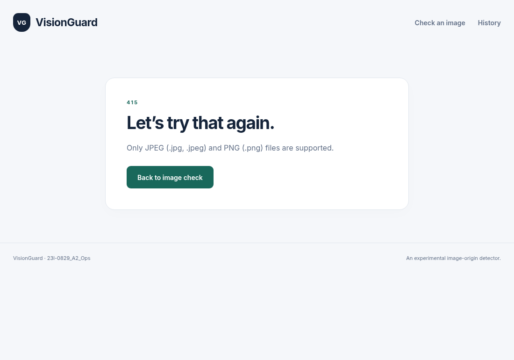
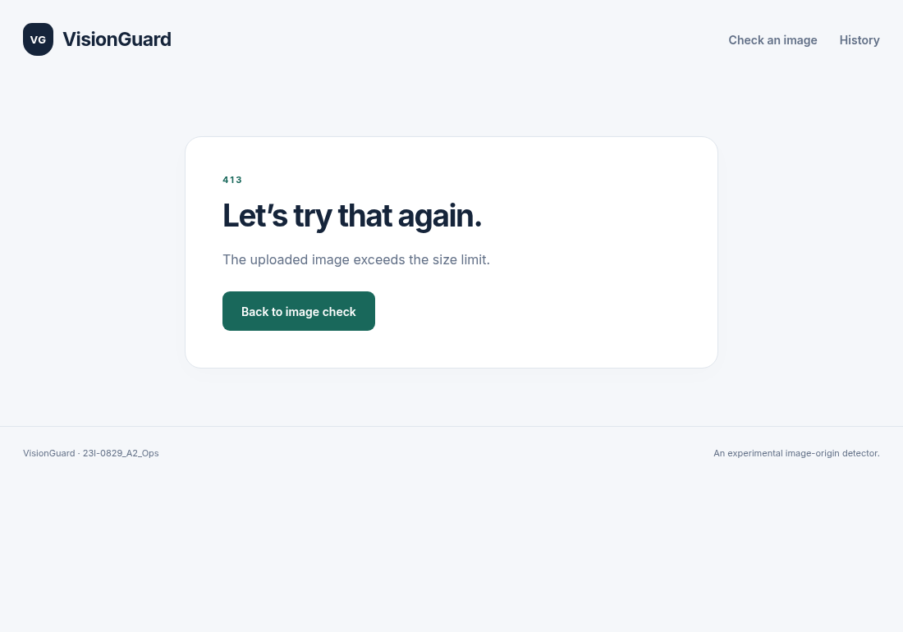
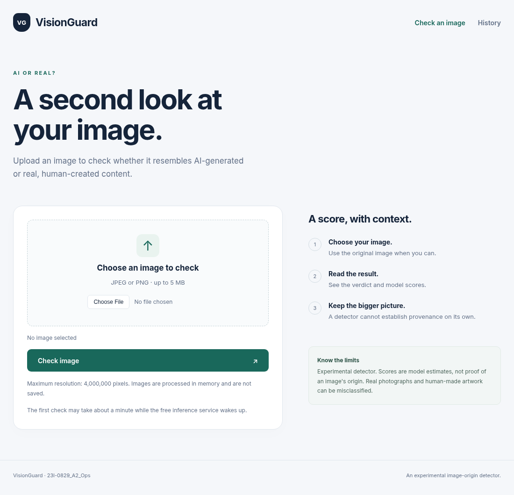
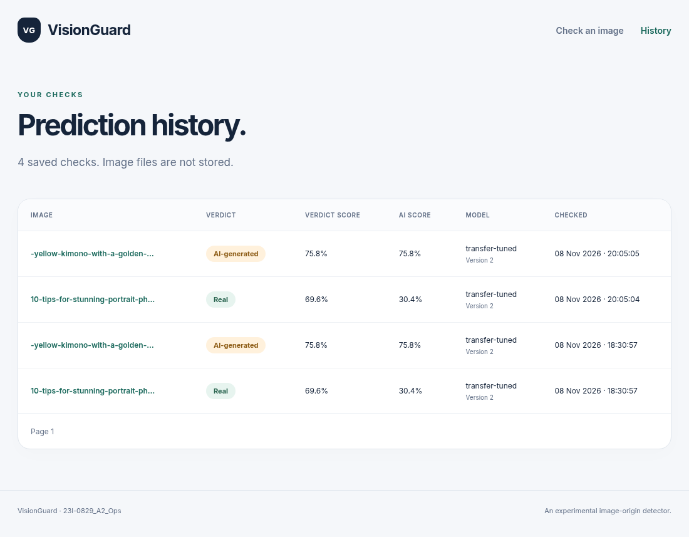
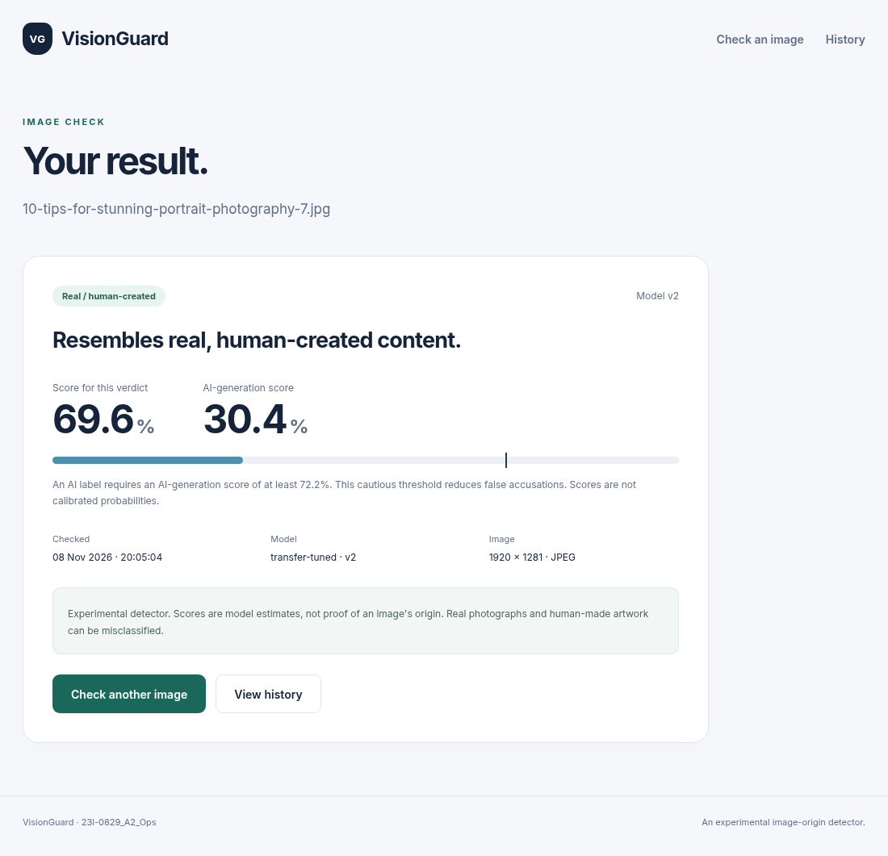
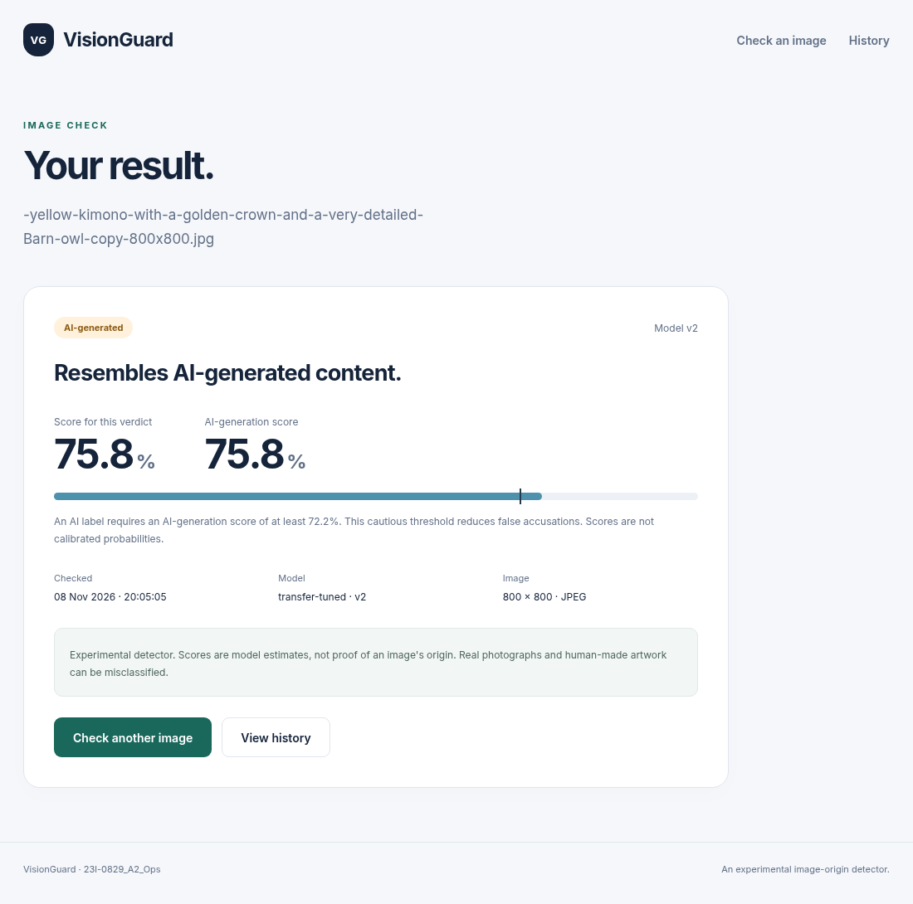

# VisionGuard

## AI vs Real Image Classification and Deployment

**MLOps Assignment 2 · Saad Zafar · 23l-0829**  
**Project:** 23l-0829_A2_Ops · **Date:** {{REPORT_DATE}}

| Submission resource | Link |
|---|---|
| GitHub source | [saadzafar0/mlops-assignment-visionguard](https://github.com/saadzafar0/mlops-assignment-visionguard) |
| DagsHub data, tracking and registry | [DagsHub project](https://dagshub.com/saadzafar0/mlops-assignment-visionguard) |
| Public model API | [mlops-assignment-visionguard.onrender.com](https://mlops-assignment-visionguard.onrender.com) |
| API readiness | [GET /health](https://mlops-assignment-visionguard.onrender.com/health) |
| Local browser application | http://127.0.0.1:5000 |

**Graded application revision:**

`{{SOURCE_REVISION}}`

## Outcome

VisionGuard classifies an uploaded JPEG or PNG using a fine-tuned MobileNetV2. The model API runs on Render; the Flask interface and persistent history run locally. This follows Task 7's instruction to call a cloud model from localhost Flask. The repository slug retains its original name; the experiment and registry use the roll-number project name above.

| Held-out test result | Baseline CNN | Tuned MobileNetV2 |
|---|---|---|
| Accuracy | 49.66% | 75.51% |
| AI precision / recall | 81.82% / 11.11% | 92.45% / 60.49% |
| F1 / ROC-AUC | 0.1957 / 0.6727 | 0.7313 / 0.9126 |

The detector is experimental. Its confidence is a model score, not proof of an image's origin. The threshold prioritizes avoiding false accusations against real images.

## Assistance and evidence

OpenAI Codex assisted with repository setup, implementation, debugging, experiment execution, validation, documentation and preparation of this report. Official documentation informed the tool configuration. Results below come from recorded project artifacts; no training or test evaluation was repeated to prepare this PDF.

API evidence uses **curl instead of Postman**, as requested. Figures are generated from recorded results; browser captures show the actual local application. Some historical terminal and service-dashboard screenshots were not captured: their measured outputs and source links are supplied, with remaining evidence gaps listed at the end. No numeric page limit appears in the supplied assignment PDF.

---

# Task 1 · Data understanding and versioning

## 1.1 Environment

An isolated Python environment and `uv.lock` separate project dependencies from system Python. The recorded environment used Python 3.12.12, TensorFlow 2.20.0 and Keras 3.15.1. TensorFlow detected one CPU and zero GPUs; CUDA support was false. Training therefore used CPU execution. Exact packages and platform details are saved in `reports/generated/environment/`.

## 1.2 Dataset audit

The audit walks the Kaggle dataset, decodes each image and records its class, bytes, dimensions, colour mode, detected format and SHA-256. Decoder output is used because filename extensions alone cannot establish validity. All 975 files decoded; one exact duplicate and no conflicting duplicate labels were found.

| Measure (minimum / median / maximum) | Real: 436 files | AI: 539 files |
|---|---|---|
| Width, pixels | 183 / 920 / 8,495 | 225 / 1,024 / 6,000 |
| Height, pixels | 158 / 720 / 7,091 | 135 / 800 / 4,001 |
| File size, bytes | 11,311 / 144,840 / 10,195,352 | 11,738 / 199,760 / 5,626,183 |
| JPEG / PNG | 403 / 33 | 429 / 110 |

`AiArtData/image34.jpg` duplicates `image33.jpg`. Removing one copy leaves 974 unique images. Stratified splits with seed 42 contain 681 training (305 real, 376 AI), 146 validation (65 real, 81 AI) and 147 test (66 real, 81 AI) images. No content hash crosses a split, preventing exact-duplicate leakage.

## 1.3 Visual EDA

The sample grid above includes photographs, artwork and stylized compositions. The real class is not exclusively camera photographs, so artistic style alone is an unreliable label cue. This ambiguity can explain errors on illustrations and polished portraits.

---

# Task 1 · EDA and DVC continued

The width histogram shows a broad range and a higher median for AI images (1,024 versus 920 pixels). A fixed input size controls memory use, while source resolution could otherwise become a shortcut feature. The height histogram also spans a wide range; AI median height is 800 versus 720 pixels. Padding during resizing preserves shape instead of stretching portraits and landscapes.

File sizes have long tails, with real images reaching about 10.2 MB. Compressed file size is not equivalent to image content or pixel count; upload-size restrictions and decoded-image checks address different issues.

## 1.4 DVC toy and applied versioning

The toy repository tracked a CSV in two Git commits, `851b3c4` and `5a5fe62`. After changing the CSV, checkout plus `dvc checkout` restored the older version. A local remote supported `dvc push`; deleting local data/cache and running `dvc pull` demonstrated restoration. The recorded transcript is in `reports/generated/dvc_toy/`. These toy commits remain local; their DagsHub publication is an outstanding requirement.

For VisionGuard, Git tracks small `.dvc` pointer files and code; DagsHub storage holds the dataset and generated artifacts. The dataset directory hash is `b2cec67839f742df4653f66d4bcbbafb.dir`. A pointer records a content identifier, path and size metadata, allowing the right bytes to be retrieved without placing large binaries in Git history. Credentials belong in ignored local configuration; `.env` and `.dvc/config.local` are excluded from Git.

---

# Task 2 · Model development

## 2.1 Input pipeline

Split CSVs drive `tf.data`: read bytes, decode RGB, resize with padding to 128 × 128, batch and prefetch. Padding preserves aspect ratio, while the small input keeps CPU training practical. Augmentation runs only on training images; validation and test processing remain deterministic. Pixel values remain on the 0–255 scale until the model's own rescaling layer.

## 2.2 Baseline CNN

Convolutions learn local features; normalization stabilizes activations; pooling reduces resolution. Global average pooling limits classifier parameters, and dropout discourages reliance on individual features. The sigmoid estimates the AI class probability. Binary cross-entropy matches the two-class target, Adam supplies adaptive optimization, and AUC complements threshold-dependent accuracy.

| Layer or operation | Output shape, excluding batch | Parameters |
|---|---|---|
| Input; rescale to 0–1 | 128 × 128 × 3 | 0 |
| Conv1; batch normalization; ReLU | 128 × 128 × 16 | 432 + 64 |
| Max pool | 64 × 64 × 16 | 0 |
| Conv2; batch normalization; ReLU | 64 × 64 × 32 | 4,608 + 128 |
| Max pool | 32 × 32 × 32 | 0 |
| Conv3; batch normalization; ReLU | 32 × 32 × 64 | 18,432 + 256 |
| Max pool; global average pool | 16 × 16 × 64; then 64 | 0 |
| Dense 64; dropout | 64 | 4,160 |
| Sigmoid output | 1 | 65 |

Total: **28,145 parameters**, including 27,921 trainable parameters and 224 non-trainable normalization statistics. Full layer summaries are retained with the model artifacts.

---

# Task 2 · Transfer learning and discipline

## 2.3 Pretrained model and fine-tuning

MobileNetV2 with width multiplier 0.5 supplies a lightweight pretrained backbone without its original classifier. Global average pooling, dropout and a sigmoid head produce the binary output. The network contains 707,505 parameters: 706,224 in the backbone and 1,281 in the head. Internal rescaling maps RGB values to −1…1, matching MobileNetV2 preprocessing.

The first stage freezes the backbone and trains only the head. The reference second stage unfreezes `block_16_expand`, `block_16_depthwise`, `block_16_project` and `Conv_1`, plus the output head; batch-normalization layers stay frozen. A smaller fine-tuning learning rate protects pretrained features. The final tuned model unfreezes only `Conv_1` and the head.

The paired curves above separate head adaptation from backbone updates. The best reference validation-loss checkpoints occurred at head epoch 8 and fine-tuning epoch 5; the selected tuned model's best epoch was 4.

## 2.4 Training discipline

Seed 42 and deterministic operations make runs easier to reproduce. Early stopping uses patience 4; learning-rate reduction multiplies the rate by 0.5 after two unimproved epochs. Checkpoints retain minimum validation loss rather than the final epoch. Maximum budgets were 12 epochs for the CNN, 8 for the frozen head, 6 for fine-tuning and 4 per tuning trial.

The selected baseline without augmentation reached its best validation loss at epoch 11 (0.6604). The tuned transfer checkpoint reached 0.4493 at epoch 4. Short training budgets and a small validation set limit certainty; comparisons use stored checkpoints and consistent splits.

---

# Task 2 · Evaluation and error analysis

## 2.5 Held-out evaluation

Validation data selected the threshold by minimizing **3 × false positives + false negatives**: wrongly calling a real image AI-generated is treated as more costly. Champion ranking used validation AUC first. Both chosen models were then evaluated on the held-out test set; test results did not select the threshold or champion.

| Model | Accuracy | Precision | Recall | F1 | ROC-AUC |
|---|---|---|---|---|---|
| Baseline, no augmentation | 0.4966 | 0.8182 | 0.1111 | 0.1957 | 0.6727 |
| Tuned transfer | 0.7551 | 0.9245 | 0.6049 | 0.7313 | 0.9126 |

Thresholds are 0.663497 (baseline) and **0.722471** (transfer). The transfer model finds 49 of 81 AI images while falsely flagging four of 66 real images. Its 32 missed AI images show why a high precision score does not make the detector definitive.

## 2.6 Ten misclassified test images

In grid order, plausible explanations are: **1** photographic mist and landscape texture; **2** realistic animal fur and lighting; **3** a real image's vivid graphic background; **4** realistic paired faces; **5** an overhead animal/maze composition; **6** polished office-portrait lighting; **7** saturated human-made illustration; **8** smooth monochrome portrait shading near the threshold; **9** mixed sketch/landscape layout; **10** pop-art print styling. These are visual hypotheses, not proven causes, and were not used to retune on the test set.

---

# Task 2 · Keras Tuner lab

## 2.7 Toy search and applied search

The toy lab uses the built-in sklearn digits dataset, avoiding an external dataset download. Random search varies dense units and learning rate. All four results are retained rather than reporting only the winner.

| Dense units | Learning rate | Validation accuracy |
|---|---|---|
| 32 | 0.001 | 0.6861 |
| 64 | 0.001 | 0.8306 |
| 64 | 0.01 | **0.9583** |
| 16 | 0.001 | 0.4667 |

The VisionGuard search runs eight trials over dropout, number of unfrozen convolutional layers and fine-tuning learning rate. Lower validation loss wins within this search; the resulting candidate is then compared with the other candidates using the declared validation-AUC ranking.

| Trial | Dropout | Unfrozen layers | Learning rate | Best validation loss |
|---|---|---|---|---|
| 0 | 0.3 | 1 | 0.00003 | 0.464460 |
| 1 | 0.1 | 4 | 0.00003 | 0.458472 |
| 2 | 0.5 | 1 | 0.00010 | **0.449338** |
| 3 | 0.1 | 2 | 0.00001 | 0.473581 |
| 4 | 0.1 | 2 | 0.00010 | 0.463051 |
| 5 | 0.3 | 2 | 0.00003 | 0.451045 |
| 6 | 0.1 | 1 | 0.00010 | 0.463328 |
| 7 | 0.5 | 4 | 0.00001 | 0.471225 |

Learning rate had the largest range of grouped mean validation losses (about 0.0144), followed by dropout (0.0069) and unfrozen layers (0.0058). This suggests learning rate mattered most within this sampled search, but eight unbalanced trials cannot establish a causal ranking.

Repeatedly choosing the best validation score can overfit validation noise. The test set therefore remains separate, and the modest dataset size limits generalization claims. No Grad-CAM bonus is claimed.

---

# Task 3 · MLflow and DagsHub

## 3.1 Local MLflow lab

An **experiment** groups related training work; a **run** records one execution. A **parameter** is a chosen setting, a **metric** is a measured numeric result, an **artifact** is a saved file, and a **tag** supplies descriptive context such as a Git revision. The toy network trains on 1,437 digits and validates on 360, using a dense 32-unit hidden layer and ten-class softmax output for six epochs.

| Learning rate | Final validation accuracy | Validation loss |
|---|---|---|
| 0.001 | 84.17% | 1.034715 |
| 0.01 | 95.00% | 0.150037 |

Both runs logged parameters, per-epoch metrics, a plot and the model. The higher rate converged faster within this short budget. These are saved artifact plots, not screenshots of the MLflow comparison interface.

## 3.2 DagsHub setup

DagsHub is linked to the GitHub repository. Its tracking endpoint is `https://dagshub.com/saadzafar0/mlops-assignment-visionguard.mlflow`. The access token is supplied through environment variables loaded from ignored `.env`; no token is included in this report. The repeated remote toy run reached 95% validation accuracy, run ID `2f366ee2f8c148b89b249bdb3da7b338`.

## 3.3 Instrumentation and 3.4 artifacts

Manual instrumentation logs the selected hyperparameters, epoch metrics, final test metrics and reproducibility tags: Git revision, DVC data version and seed. A second path uses TensorFlow autologging. Autologging reduces routine callback code, while manual logging is still needed for dataset provenance, threshold policy and project-specific evaluation artifacts.

Run artifacts include confusion matrices, ROC curves, split lists, package versions and trained Keras models. They connect a numeric result to the exact data and software used. Scripts and detailed run records are indexed in `docs/task3.md`; generated results live under `reports/generated/`.

---

# Task 3 · Comparison and registry

## 3.5 Controlled experiment comparison

Six initial candidates vary meaningful settings around baseline and transfer references; the tuner contributes a seventh candidate. Validation AUC is the primary selection criterion because it measures score ranking before applying the product's conservative decision threshold.

| Candidate | Val. AUC | Precision | Recall | F1 | 3FP + FN |
|---|---|---|---|---|---|
| Baseline: lower learning rate | 0.5953 | 0.7812 | 0.3086 | 0.4425 | 77 |
| Baseline: no augmentation | 0.6821 | 1.0000 | 0.1358 | 0.2391 | 70 |
| Baseline: reference | 0.5901 | 0.7857 | 0.2716 | 0.4037 | 77 |
| Transfer: fewer unfrozen | 0.8636 | 0.9583 | 0.5679 | 0.7132 | 41 |
| Transfer: lower dropout | 0.8655 | 0.9600 | 0.5926 | 0.7328 | 39 |
| Transfer: reference | 0.8650 | 0.9583 | 0.5679 | 0.7132 | 41 |
| Transfer: tuned | **0.8750** | 0.9412 | 0.5926 | 0.7273 | 42 |

The tuned candidate wins by AUC, although lower dropout has a lower validation error cost (39 versus 42). This trade-off is explicit: champion selection did not retrospectively switch criteria to favor a preferred model.

## 3.6 Registry and model delivery

Registry model `23l-0829_A2_Ops` contains version 1 (transfer-lower-dropout) and version 2 (transfer-tuned). Alias **champion** points to version 2. The separate alias-loading script predicted AI for the validation owl image, with AI probability 0.757909596 and threshold 0.722470641.

A DagsHub compatibility issue affected legacy `runs:/` registration; registration through native MLflow logged-model IDs resolved it. Deployment pins the model version and checksum in `deploy/model.lock.json`, downloads and verifies the artifact at build time, and exports SavedModel. Serving does not query DagsHub on every request.

---

# Task 4 · Flask web application

## 4.1 Inference module

The local Keras backend loads the champion once at startup. The deployed backend loads its SavedModel once in TensorFlow Serving, and Flask sends requests to it. Loading per request would repeat expensive initialization and increase latency. Shared RGB decoding and padded resizing preserve training/serving preprocessing. Two known validation images returned real at AI probability 0.304311 and AI at 0.757909.

## 4.2 Routes and validation

`/` provides upload, `/predict` handles inference, `/result/<id>` displays a saved decision, `/history` queries records and `/health` checks readiness. Only JPEG/PNG uploads up to 5 MB are accepted. Files must actually decode as images; names are sanitized and original uploaded bytes are not retained on disk.

The three captures above show friendly recovery pages rather than server tracebacks. They were captured from localhost on 8 November 2026; the application footer identifies the project.

## 4.3 HTML/CSS and 4.4 configuration

The interface offers an image picker, preview, result card and history menu. Results display a confidence score and an explicit uncertainty caveat. Environment variables configure the model path, threshold, backend and database address; credentials stay outside source control. Gunicorn runs with debug disabled so public requests cannot open an interactive debugger. Readiness reports the loaded champion and model version.

---

# Task 5 · Database trail

Successful predictions are saved transactionally through SQLAlchemy. SQLite supplies persistent local history; the Compose deployment uses PostgreSQL with a named volume. A restart therefore does not erase the audit trail.

| Stored fields | Purpose |
|---|---|
| UUID and UTC creation time | Identify and order individual decisions |
| Sanitized filename, SHA-256, format and dimensions | Describe the input without retaining image bytes |
| Label, AI probability, confidence and threshold | Explain the decision made at that time |
| Model name, version and SHA-256 | Identify the exact model artifact |
| Backend and latency | Distinguish local/cloud execution and timing |

A separate request log stores request ID, timestamp, method, path, HTTP status and duration, including failed requests. Invalid uploads do not create successful prediction records. Parameterized database operations avoid building SQL from uploaded names, and history is paginated.

The history page above displays recorded predictions rather than keeping transient browser state. Local-to-cloud verification stored two remote-backed predictions and confirmed that both remained queryable after a graceful Gunicorn worker reload. The real-image record ID is `a75b8911-684b-40b9-8bef-034da64c6bcd`; the AI record ID is `2ac13b11-c71c-4b1f-ae7d-771a3ef4e276`.

The public inference API is stateless. Persistence belongs to the local Flask application in the submitted cloud-integration arrangement; PostgreSQL is used in the separate reproducible Compose stack.

---

# Task 6 · Containers and CI

## 6.1 Docker warm-up

The recorded CI warm-up covers running a ready-made image, mapping a port, mounting a volume, reading logs, opening a shell, listing and removing resources. An **image** is a reusable filesystem/configuration template; a **container** is its running instance; a **layer** is a cached build change; a **volume** persists data beyond a container; a **port mapping** forwards a host port to a container port. The project CI log contains the executed commands and results.

## 6.2 Dockerfile and 6.3 Compose

The [Dockerfile](https://github.com/saadzafar0/mlops-assignment-visionguard/blob/main/Dockerfile) installs dependency files before copying source, allowing Docker to reuse dependency layers for code-only edits. Slim Python, CPU TensorFlow, no pip cache and `.dockerignore` reduce unnecessary content. The runtime runs as `appuser`, and health checks test readiness. Secrets are excluded from the image.

The Compose stack runs web and PostgreSQL services on an internal network. Web connects using the database service name. PostgreSQL has a named data volume and a readiness check; web waits for healthy database startup. No database port is published to the host. Passwords come from ignored `.env`, with placeholder settings documented in `.env.example`.

The model is pinned and built into the image so startup is independent of registry availability. `docker compose up --build` builds and starts the reproducible stack. The host environment could not create Docker bridge/veth networking, so full Compose connectivity and persistence were checked on the GitHub runner instead of claiming a local success.

## 6.4 Image analysis

| Measured image | Size in bytes | Runtime |
|---|---|---|
| Web image | 2,200,499,661 | Python TensorFlow, UI and history |
| Optimized API image | 1,216,319,411 | Thin Flask and C++ TensorFlow Serving |

The API image is 44.73% smaller. Multi-stage export keeps Python TensorFlow out of the final inference image; model/runtime dependency layers dominate size. These images serve the same champion but have different features, so this is an architectural reduction rather than an identical-feature comparison. A 512 MiB container test passed, with a recorded peak of about 325.4 MiB including the test client.

## 6.5 Operations and 6.6 GitHub Actions

The integration workflow exercises service startup, logs, shells, stop/restart and persistent history. An intentional wrong database password produced authentication failure; correcting it restored readiness. This distinguishes a configuration problem from a model failure. The project workflow runs linting, 27 tests, Docker build and Compose integration; credentials belong in GitHub Actions secrets, not workflow text.

The separate toy repository ran a Python 3.11/3.12 matrix: [intentional red run](https://github.com/saadzafar0/23l-0829_A2_Ops-ci-toy/actions/runs/42490780163), then [fixed green run](https://github.com/saadzafar0/23l-0829_A2_Ops-ci-toy/actions/runs/42490817253). The main repository includes a CI badge and a [successful project run](https://github.com/saadzafar0/mlops-assignment-visionguard/actions/runs/42492465408). Machine-readable run metadata and logs are retained under `reports/generated/ci*`.

---

# Task 7 · Public API deployment

## Deployment procedure

Render hosts the model API as a Docker web service. The frontend and database remain local for the assignment's localhost-to-cloud flow.

1. Connect the GitHub repository to Render and select the main branch and repository Dockerfile. Use the inference image target/settings recorded in `render.yaml` and `docs/deployment.md`.
2. Set `INFERENCE_API_KEY` to a nonempty private value in Render Environment settings. Use the same value in local `.env`; do not commit or display it.
3. Build the pinned champion: verify its checksum, export SavedModel and copy it into the inference image. This fixes the deployed version independently of later registry alias changes.
4. Start TensorFlow Serving on its internal endpoint, wait for model readiness, then start Gunicorn on `0.0.0.0:$PORT`. The startup script selects the TensorFlow Serving backend explicitly.
5. Set the service health-check path to `/health`, deploy and confirm the model name/version. Send authenticated multipart requests to `/predict`.
6. Configure the local Flask backend as `remote`, set the public API URL and run Flask through Gunicorn. Verify browser results and persistent history.

## Actual failures and fixes

The first deployment loaded the model but failed with `Set INFERENCE_API_KEY before starting the public inference API`. Adding the key in Render fixed that configuration error. A later failure, `ModuleNotFoundError: No module named 'tensorflow'`, occurred because a local-backend setting selected Python Keras inside the thin serving image. The startup script now forces the TensorFlow Serving backend and its internal URL; Python TensorFlow is intentionally absent from that final image.

## curl verification

**API:** https://mlops-assignment-visionguard.onrender.com  
**Recorded check:** {{CURL_CAPTURE_DATE}} (UTC).

| Request | HTTP status | Recorded result |
|---|---|---|
| GET /health | 200 | ready; transfer-tuned; version 2 |
| POST /predict without key | 401 | valid API key required |
| Real validation image | 200 | real; AI probability 0.304310948 |
| AI validation image | 200 | AI; AI probability 0.757909358 |
| wrong.txt | 415 | unsupported file type |
| broken.jpg | 422 | image cannot be decoded |
| oversized.png | 413 | larger than 5 MB |

`curl /health` checks readiness; `curl --config - -F image=@FILE .../predict` sends a multipart image with the secret header supplied privately on stdin. `scripts/capture_report_curl.py` records the actual responses without exposing the key. Full evidence is in `reports/generated/report/curl_transcript.txt`.

An [independent GitHub-hosted runner](https://github.com/saadzafar0/mlops-assignment-visionguard/actions/runs/42493436435) reached the API from another network and received health 200 and unauthenticated prediction 401. Authenticated image predictions were verified from the local client; these are distinct checks.

---

# Task 8 · Local Flask and cloud integration

The browser uploads to local Flask. Flask validates the image, calls the authenticated Render API, saves the returned decision in SQLite and redirects to the result page. The API key stays on the server and is not sent to browser JavaScript. The history menu reads saved records from the database.

The two result captures above demonstrate different inputs and outputs from the deployed model. The Task 5 history capture shows database persistence for the same workflow.

| Validation input | AI probability | Displayed verdict / confidence |
|---|---|---|
| Portrait photograph | 0.304310948 | Real / 69.57% |
| Stylized owl image | 0.757909358 | AI / 75.79% |

The verdict uses the validation-selected threshold 0.722470641; confidence is the predicted class's score. Small numerical differences between CPU hosts were at most 0.000002292 for these images, within the 0.00001 agreement tolerance. Both remote-backed records survived a worker reload, as recorded in `reports/generated/serving/remote_web_smoke.json`.

## Evidence limits and references

This concise report includes real output figures, measured tables, curl responses and actual local-browser captures. Historical screenshots of environment commands, DVC commits, MLflow/DagsHub run and registry pages, Docker operations, CI dashboards and Render deployment steps remain absent; linked logs and artifacts do not fully replace the assignment's screenshot requirement. The DVC toy's two commits also still need publication to DagsHub. No unobserved screenshots, deployment actions or test outcomes are claimed.

Implementation details and reproducible commands are in `docs/task1.md` through the task-specific documents, `docs/deployment.md`, `docs/task7_8.md` and `labs/README.md`. Relevant primary references: [Kaggle dataset](https://www.kaggle.com/datasets/cashbowman/ai-generated-images-vs-real-images), [TensorFlow data guide](https://www.tensorflow.org/guide/data), [Keras MobileNetV2](https://keras.io/api/applications/mobilenet/), [Keras Tuner](https://keras.io/keras_tuner/), [MLflow documentation](https://mlflow.org/docs/latest/), [DVC documentation](https://dvc.org/doc), [Docker Compose](https://docs.docker.com/compose/), and [Render Docker deployment](https://render.com/docs/docker).
